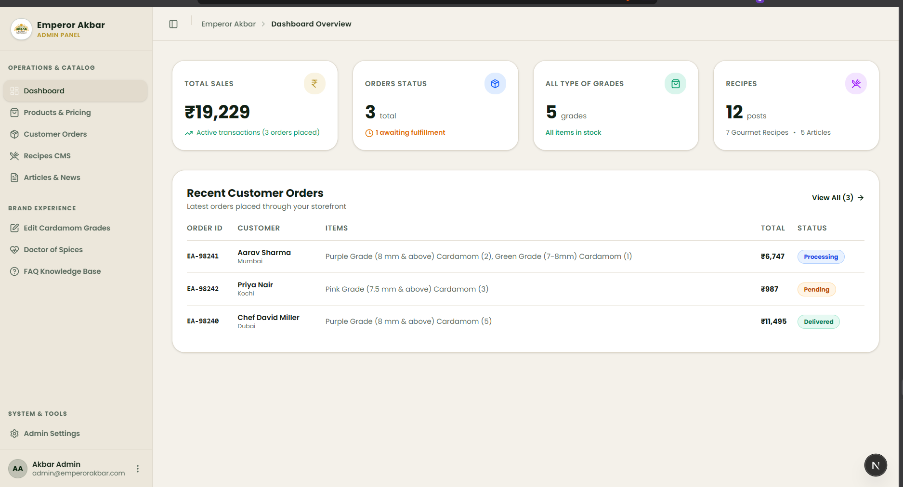
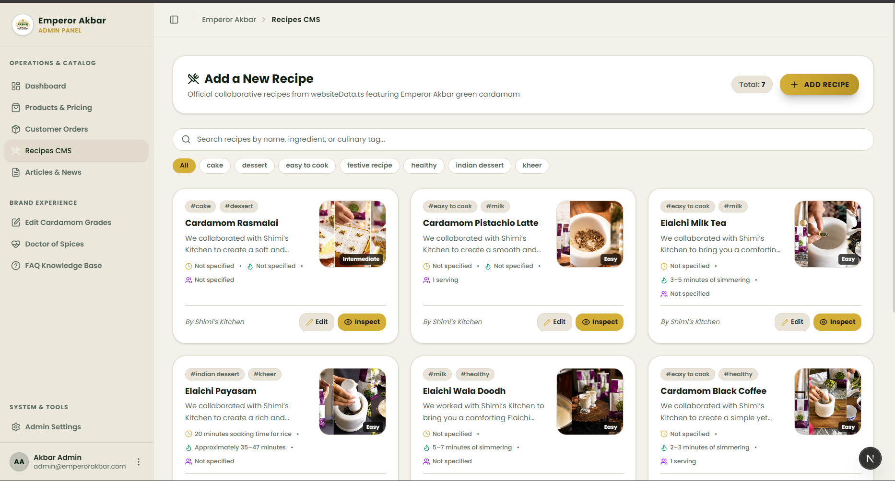

# 👑 Emperor Akbar Cardamom — Admin Panel & CMS Suite

A luxury, high-performance administrative control center and client-side Content Management System (CMS) engineered for the **Emperor Akbar Green Cardamom** digital ecosystem.

Built to serve as the unified back-office companion to the **[Emperor Akbar Website Redesign](https://github.com/dotsatya/EmperorAkbar-Cardamom-Web-Redesign)**, this suite grants catalog managers, culinary curators, and store operators complete real-time authority over products, pod grading benchmarks, gourmet recipes, editorial stories, customer orders, and storefront hero configurations.

---

## 🌐 Live Deployment & Project Links

| Resource | Direct Link |
| :--- | :--- |
| 🚀 **Live Admin Suite (GitHub Pages)** | **[https://dotsatya.github.io/EmperorAkbar-Cardamom-Web-Admin-panel/](https://dotsatya.github.io/EmperorAkbar-Cardamom-Web-Admin-panel/)** |
| 📦 **Admin Suite GitHub Repository** | **[dotsatya/EmperorAkbar-Cardamom-Web-Admin-panel](https://github.com/dotsatya/EmperorAkbar-Cardamom-Web-Admin-panel)** |
| 🌿 **Redesigned Storefront (Live)** | **[https://dotsatya.github.io/EmperorAkbar-Cardamom-Web-Redesign/](https://dotsatya.github.io/EmperorAkbar-Cardamom-Web-Redesign/)** |
| 📂 **Storefront GitHub Repository** | **[dotsatya/EmperorAkbar-Cardamom-Web-Redesign](https://github.com/dotsatya/EmperorAkbar-Cardamom-Web-Redesign)** |
| 🏛️ **Original Brand Store** | **[https://www.emperorakbar.com/](https://www.emperorakbar.com/)** |

---

## 📸 Admin Suite Interface Preview

### 📊 1. Executive Dashboard Overview
<div align="center">
  
  <p><em>Executive Overview: Real-time sales revenue, order fulfillment pipeline, active pod inventory, and content publishing stats.</em></p>
</div>

<br />

### 🍽️ 2. Gourmet Recipes CMS Studio (Shimi's Kitchen)
<div align="center">
  
  <p><em>Culinary Studio: Manage collaborative Alleppey recipes, dietary tags, step-by-step directions, and chef author profiles.</em></p>
</div>

---

## 🎯 Architecture & Ecosystem Vision

The Emperor Akbar e-commerce platform consists of two specialized applications working together harmoniously:

```
                      ┌────────────────────────────────────────────────────────┐
                      │          Emperor Akbar Digital Flagship                │
                      └──────────────────────────┬─────────────────────────────┘
                                                 │
                   ┌─────────────────────────────┴─────────────────────────────┐
                   ▼                                                           ▼
    🌿 Customer Storefront                                      👑 Admin Suite & CMS
    (EmperorAkbar-Cardamom-Web-Redesign)                        (EmperorAkbar-Cardamom-Web-Admin-panel)
    • Luxury Flagship Storefront                                • Executive Sales & Analytics Dashboard
    • Interactive Grading Visualizer                            • Products & Pod Grading CMS
    • Cart, Checkout & Weight Selectors                         • Order Fulfillment & Dispatch Pipeline
    • Recipes (Shimi's Kitchen) & Blogs                         • Gourmet Recipes & Health Articles Studio
    • Responsive Luxury Design System                           • Backup, Snapshot Export & Instant Restore
```

---

## ✨ Features & Management Modules

### 1. 📊 Executive Dashboard & Analytics
* **Business KPI Cards**: Real-time overview of gross sales revenue, fulfilled vs. pending orders, active pod grades in catalog, and published culinary articles.
* **Interactive Sales Curve**: High-resolution chart visualizer showing monthly revenue trends and transaction volumes powered by Recharts.
* **Recent Orders Feed**: Quick-glance stream of incoming purchases with direct customer name, order ID, price, and status badges.
* **Rapid Action Shortcuts**: One-click jumps to add new products, publish recipes, or adjust grading parameters.

### 2. 🛍️ Products & Cardamom Grades CMS
* **GI-Tag Pod Grades**: Full management of Emperor Akbar's signature grading tiers:
  * 🟣 **Purple Grade (8 mm & above)** — The crown jewel pod
  * 🌸 **Pink Grade (7.5 mm & above)** — High-grade bold pods
  * 🟢 **Green Grade (7 mm – 8 mm)** — Classic Alleppey culinary grade
  * 🟠 **Orange Grade (6.5 mm – 7 mm)** — Teas & fragrant seasoning
  * 🔴 **Red Grade (6 mm – 6.5 mm)** — High essential oil concentration
* **Price & Weight Variants**: Define live pricing, discount rates, stock availability, and package sizes (50g, 100g, 250g, 500g).
* **Catalog Badges**: Toggle promotional flags such as *Bestseller*, *Limited Harvest*, *Sale*, and *Sold Out*.
* **Aroma-Lock Metadata**: Edit harvest origins, moisture percentages, aroma-lock notes, and high-resolution packaging imagery.
* **Search & Filter Dropdown**: Responsive search bar paired side-by-side with an inventory status dropdown (*All Items*, *In Stock*, *Sold Out*, *On Sale*) featuring real-time quantity counts, status dots, and one-click reset.

### 3. 📦 Customer Orders & Fulfillment Pipeline
* **Lifecycle State Machine**: Move customer orders across 5 clear fulfillment stages:
  $$\text{Pending} \longrightarrow \text{Processing} \longrightarrow \text{Shipped} \longrightarrow \text{Delivered} \quad (\text{or } \text{Cancelled})$$
* **Detailed Order Inspector**: Inspect shipping addresses, recipient contact numbers, email addresses, ordered package sizes, unit quantities, and payment methods.
* **Search & Status Filter Dropdown**: Real-time search by Order ID, customer, phone, or city paired side-by-side with a color-coded status dropdown (*All Orders*, *Pending*, *Processing*, *Shipped*, *Delivered*, *Cancelled*) displaying live order count badges.

### 4. 🍽️ Gourmet Recipes Studio (Shimi's Kitchen)
* **Collaborative Recipe Archive**: Create, update, and organize gourmet dishes featuring Alleppey green cardamom (Cardamom Rasmalai, Pistachio Latte, Elaichi Milk Tea, Elaichi Payasam).
* **Search & Category Filter Dropdown**: Unified search input paired side-by-side with a scrollable culinary tag dropdown featuring recipe counters per category and instant reset.
* **Structured Preparation Details**: Set preparation time, cooking time, difficulty level, chef author, servings, and tags.
* **Ingredient & Step Builder**: Drag-and-drop enabled ingredient checklists and numbered cooking directions.

### 5. 📰 Articles & Market Insights (Blogs CMS)
* **Cardamom Knowledge Base**: Publish reports on Alleppey crop outlooks, global auction prices, storage guidelines, and GI-tag validation.
* **Editorial Studio**: Manage article titles, introductory summaries, rich paragraph blocks, author attributions, read-time estimates, and video embeds.

### 6. 🔬 Quality Grading Benchmarks
* Benchmark diameter parameters and physical inspection criteria used across sorting facilities.
* Powers the interactive visualizer on the customer storefront at `/cardamom-grades`.

### 7. 🩺 "Doctor of Spices" Health & Wellness CMS
* Curate scientifically backed and Ayurvedic health benefits of green cardamom (digestive stimulation, oral wellness, antioxidant properties, respiratory support).
* Directly updates the storefront `/health-benefits` section.

### 8. ❓ FAQ Knowledge Base
* Manage categorized customer support accordions covering Pod Grading & Quality, Aroma-Lock Packaging & Storage, and Shipping & International Orders.

### 9. ⚙️ Global Storefront & Hero Configuration
* **Announcement Banner**: Configure top header ticker text, promotional links, and toggle visibility.
* **Storefront Hero Copy**: Update hero headlines, brand taglines, sub-descriptions, and chef testimonials without touching code.
* **Brand Contact & Socials**: Configure customer service hotlines, WhatsApp numbers, headquarters address, and social links.

### 10. 💾 Snapshot Backup & Data Resilience
* **Export Snapshot**: One-click download of the complete website database and CMS content in clean JSON format.
* **Restore Snapshot**: Drag-and-drop or select any JSON backup file to instantly restore all products, orders, and settings.
* **Factory Reset**: Instant rollback to master seed data.

---

## 🛠️ Technology Stack & Architecture

| Layer | Technologies |
| :--- | :--- |
| **Framework** | [Next.js 16.4](https://nextjs.org/) (App Router, Turbopack, Static Export) |
| **UI Library** | [React 19.3](https://react.dev/) |
| **Language** | [TypeScript 5](https://www.typescriptlang.org/) |
| **Styling** | [Tailwind CSS v4](https://tailwindcss.com/) + CSS Design Tokens |
| **Component Primitives** | Base UI / Shadcn UI primitives |
| **Charts & Data Visuals** | [Recharts 3.8](https://recharts.org/) |
| **Drag & Drop** | `@dnd-kit/core`, `@dnd-kit/sortable` |
| **Icons** | [Lucide React](https://lucide.dev/) & [React Icons](https://react-icons.github.io/react-icons/) |
| **Notifications** | [Sonner](https://sonner.emilkowal.ski/) |
| **State & Persistence** | Browser `localStorage` with reactive custom DOM events (`emperorakbar-cms-updated`) |
| **CI / CD & Hosting** | GitHub Pages + GitHub Actions Workflow |

---

## 📁 Project Directory Structure

```
emperorakbar-web-admin-panel/
├── .github/
│   └── workflows/
│       └── deploy.yml              # Automated GitHub Actions workflow for GitHub Pages
├── app/
│   ├── favicon.ico
│   ├── globals.css                 # Theme tokens & Tailwind CSS v4 variables
│   ├── layout.tsx                  # Root HTML shell with ThemeProvider & Tooltips
│   └── page.tsx                    # Main Emperor Akbar Admin Suite entry point
├── components/
│   ├── admin/
│   │   ├── ThemeToggle/            # Luxury dark/light theme switcher
│   │   └── views/                  # Dedicated management views:
│   │       ├── BackupView.tsx      # JSON export, import & factory reset
│   │       ├── BlogsView.tsx       # Articles, blogs & market news editor
│   │       ├── DashboardView.tsx   # KPI cards, sales charts & quick actions
│   │       ├── FaqsView.tsx        # Categorized FAQ accordion builder
│   │       ├── GradingView.tsx     # Quality grading & pod diameter specs
│   │       ├── HealthView.tsx      # "Doctor of Spices" wellness editor
│   │       ├── OrdersView.tsx      # Customer orders stream & fulfillment workflow
│   │       ├── ProductsView.tsx    # Cardamom grades, prices, weights & badges
│   │       ├── RecipesView.tsx     # Gourmet recipe studio (Shimi's Kitchen)
│   │       └── SettingsView.tsx    # Storefront hero headlines & contact settings
│   ├── app-sidebar.tsx             # Collapsible luxury navigation sidebar
│   ├── nav-user.tsx                # Administrator profile & quick status
│   ├── site-header.tsx             # Dynamic breadcrumbs & sidebar trigger
│   ├── theme-provider.tsx          # Next-themes context provider
│   └── ui/                         # Reusable UI component library (buttons, tables, dialogs)
├── data/
│   └── websiteData.ts              # Seed master dataset for products, recipes & articles
├── hooks/
│   └── use-mobile.ts               # Responsive mobile detection hook
├── lib/
│   ├── adminStore.ts               # LocalStorage state management, orders store & events
│   └── utils.ts                    # ClassName merging utilities
├── public/
│   ├── .nojekyll                   # Bypasses Jekyll on GitHub Pages to serve _next/ assets
│   ├── images/                     # Packaging, seals & previews (image.png, image2.png)
│   └── purple/, pink/, green/...   # High-resolution grade photography
├── next.config.ts                  # Static export configuration (output: export, basePath)
├── package.json                    # Dependencies & deployment scripts
└── tsconfig.json
```

---

## 🚀 Getting Started Locally

### 1. Clone the repository
```bash
git clone https://github.com/dotsatya/EmperorAkbar-Cardamom-Web-Admin-panel.git
cd EmperorAkbar-Cardamom-Web-Admin-panel
```

### 2. Install dependencies
```bash
npm install
```

### 3. Launch the development server
```bash
npm run dev
```
Open **[http://localhost:3000](http://localhost:3000)** in your browser.

### 4. Build static export for production
```bash
npm run build
```
This generates the optimized static bundle in the `./out` directory.

---

## 🚢 Deployment on GitHub Pages

This project is fully configured for static export deployment to GitHub Pages under the repository path `/EmperorAkbar-Cardamom-Web-Admin-panel`:

### Static Export Configuration (`next.config.ts`)
* **`output: "export"`**: Compiles the entire application into client-side static HTML/CSS/JS without requiring a Node.js server.
* **`basePath: "/EmperorAkbar-Cardamom-Web-Admin-panel"`**: Ensures all assets, chunks, and scripts are resolved properly under GitHub Pages subpath routing.
* **`trailingSlash: true`**: Guarantees clean directory routing and prevents 404 errors on page refreshes.
* **`images: { unoptimized: true }`**: Supports static Next.js image loading on static hosts.

### Deploying from Terminal (Direct)
You can deploy directly to your `gh-pages` branch using the configured script:
```bash
npm run deploy
```

### Automated CI/CD (GitHub Actions)
The repository includes [deploy.yml](.github/workflows/deploy.yml). Every push to `main` automatically triggers GitHub Actions to run `npm run build` and deploy the `./out` directory to GitHub Pages.

---

## 📜 Available Scripts

| Command | Action |
| :--- | :--- |
| **`npm run dev`** | Starts local development server on `localhost:3000` with Turbopack. |
| **`npm run build`** | Runs TypeScript verification and builds the static export bundle in `./out`. |
| **`npm run deploy`** | Automatically builds and pushes the static assets to the `gh-pages` branch. |
| **`npm run start`** | Runs the production Next.js server locally. |
| **`npm run lint`** | Executes ESLint to check for code quality and syntax issues. |

---

## 👨‍💻 Author & Credits

* **Redesign & Development**: **[Satya (dotsatya)](https://github.com/dotsatya)**
* **Internship Project**: Developed during internship at **CodeWarrior Technologies Pvt. Ltd.**
* **Companion Storefront**: **[Emperor Akbar Cardamom — Website Redesign](https://github.com/dotsatya/EmperorAkbar-Cardamom-Web-Redesign)**
* **Original Brand & Asset Rights**: All trademarks, official imagery, product copy, and branding belong to **Emperor Akbar Cardamom** (Samex India Pvt. Ltd.), utilized for development and design showcase purposes.
